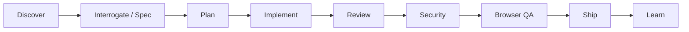

# Agent Skills — Super-Pro Developer Workflow

This repository ships a curated, project-local skill library under `.agents/skills/` so Cloud Agents and local Cursor sessions share the same workflows.

## Layered architecture

Skills are organized into layers that mirror a full engineering lifecycle:



| Layer | Purpose | Key skills |
| --- | --- | --- |
| **Discover** | Find the right skill or pattern | `/find-skills`, `/improve quick` |
| **Interrogate / Spec** | Align requirements before coding | `/grill-me`, `/grill-with-docs`, `/to-spec`, `/interrogate` |
| **Plan** | Design and break down work | `/brainstorming`, `/writing-plans`, `/ce-plan`, `/poteto-mode` |
| **Implement** | Build with rigor | `/poteto-mode`, `/tdd`, `/implement`, `/ce-work` |
| **Review** | Catch issues before merge | `/review`, `/code-review`, `/ce-code-review`, `/interrogate` |
| **Security** | Audit sensitive paths | Trail of Bits skills, `/semgrep`, `/codeql` |
| **Browser QA** | Prove changes in the real app | `/qa`, `/agent-browser`, `/ce-test-browser`, `/webapp-testing` |
| **Ship** | Land the PR | `/ship`, `/ce-commit-push-pr`, `/ce-babysit-pr` |
| **Learn** | Compound knowledge for next time | `/ce-compound`, `/continual-learning`, `/ce-compound-refresh` |

## Core 10 (daily driver)

These ten commands cover most non-trivial work:

1. `/find-skills` — discover the right skill for any task
2. `/poteto-mode` — rigorous engineering playbook (feature, bug-fix, refactor)
3. `/grill-with-docs` — align on requirements before coding
4. `/brainstorming` + `/writing-plans` — design exploration and implementation plans
5. `/tdd` — test-driven development for bug fixes
6. `/review` or `/interrogate` — code review before PR
7. `/agent-browser` or `/qa` — browser QA against the running app
8. `/ship` — land the PR with checks
9. `/ce-compound` — capture learnings after shipping
10. `/improve quick` — periodic codebase health audit

## Installed ecosystems

| Ecosystem | Source | Skills | Primary use |
| --- | --- | --- | --- |
| **pstack** | [cursor/plugins/pstack](https://github.com/cursor/plugins/tree/main/pstack) | 40+ | Rigorous engineering playbooks (`/poteto-mode`, `/how`, `/why`, `/tdd`) |
| **gstack** | [garrytan/gstack](https://github.com/garrytan/gstack) | 50+ | Virtual eng team: `/review`, `/qa`, `/ship`, `/office-hours` |
| **Superpowers** | [obra/superpowers](https://github.com/obra/superpowers) | 14 | TDD, brainstorming, plans, git worktrees, verification |
| **Matt Pocock** | [mattpocock/skills](https://github.com/mattpocock/skills) | 37 | `/grill-me`, `/triage`, `/implement`, `/to-spec`, `/code-review` |
| **improve** | [shadcn/improve](https://github.com/shadcn/improve) | 1 | Read-only codebase audit → executable plans in `plans/` |
| **Vercel** | [vercel-labs/agent-skills](https://github.com/vercel-labs/agent-skills) | 9 | React/Next best practices, deploy, web design guidelines |
| **Anthropic** | [anthropics/skills](https://github.com/anthropics/skills) | 20 | Frontend design, MCP builder, document skills, skill-creator |
| **Cloudflare** | [cloudflare/skills](https://github.com/cloudflare/skills) | 13 | Workers, Wrangler, Durable Objects, Agents SDK |
| **Stripe** | [stripe/ai](https://github.com/stripe/ai) | 8 | Payments integration best practices |
| **Trail of Bits** | [trailofbits/skills](https://github.com/trailofbits/skills) | 12 | Security review, vulnerability triage, static analysis |
| **Cursor plugins** | [cursor/plugins](https://github.com/cursor/plugins) | varies | team-kit, orchestrate, continual-learning, ralph-loop |

### Newly installed (super-pro layer)

| Ecosystem | Source | Skills added | Primary use |
| --- | --- | --- | --- |
| **find-skills** | [vercel-labs/skills](https://github.com/vercel-labs/skills) | 1 | Skill discovery across the registry |
| **agent-browser** | [vercel-labs/agent-browser](https://github.com/vercel-labs/agent-browser) | 1 | Headless browser automation for QA |
| **Compound Engineering** | [EveryInc/compound-engineering-plugin](https://github.com/EveryInc/compound-engineering-plugin) | 34 | Plan → work → review → ship → compound learnings |
| **Awesome Copilot** | [github/awesome-copilot](https://github.com/github/awesome-copilot) | 417 | Broad toolbox: specs, testing, Azure, GitHub, docs |
| **Microsoft** | [microsoft/skills](https://github.com/microsoft/skills) | 9 (selective) | MCP builder, docs, frontend review, issue creation |
| **Supabase** | [supabase/agent-skills](https://github.com/supabase/agent-skills) | 2 | Postgres best practices, Supabase patterns |

**Total:** ~763 skills in `.agents/skills/` (up from ~306).

### Already present (skipped on re-install)

- trailofbits/skills
- vercel-labs/agent-skills
- anthropics/skills
- cloudflare/skills
- stripe/ai

## Quick start

### 1. One-time project setup

```bash
# Matt Pocock — configure issue tracker + docs paths (done)
# See docs/agents/issue-tracker.md, triage-labels.md, domain.md

# pstack — choose models per role (done)
# See ~/.cursor/rules/pstack-models.mdc
```

### 2. Daily workflow commands

| When | Command |
| --- | --- |
| Find the right skill | `/find-skills <describe task>` |
| Any non-trivial task | `/poteto-mode <describe the task>` |
| Need alignment before coding | `/grill-me` or `/grill-with-docs` |
| Audit codebase for improvements | `/improve` or `/improve quick` |
| Plan a feature rigorously | `/brainstorming` then `/writing-plans` |
| Code review before PR | `/review` (gstack) or `/interrogate` (pstack) |
| Browser QA | `/agent-browser` or `/qa https://localhost:3000` |
| Ship with QA | `/ship` or `/ce-commit-push-pr` |
| Debug systematically | `/systematic-debugging` or `/poteto-mode` bug-fix playbook |
| TDD bug fix | `/tdd` |
| Capture learnings | `/ce-compound` |

### 3. Recommended stacks by task

**Feature development**
1. `/find-skills` — pick the right workflow
2. `/grill-with-docs` — align on requirements
3. `/brainstorming` — design exploration (Superpowers)
4. `/poteto-mode` feature playbook — implement with rigor
5. `/review` — gstack code review
6. `/agent-browser` — browser QA
7. `/ship` — land the PR
8. `/ce-compound` — capture learnings

**Codebase health**
1. `/improve quick` — audit and prioritize
2. Pick findings → plans land in `plans/`
3. `/improve execute 001` — dispatch executor

**Ledger Atlas (this repo)**
```bash
npm ci
npm run dev          # http://localhost:3000
npm test
npm run typecheck
npm run lint
npm run build
```

## Install / update skills

Skills are managed with the [skills CLI](https://github.com/vercel-labs/skills):

```bash
# Skill discovery (install first in any new repo)
npx skills add vercel-labs/skills --skill find-skills --agent cursor -y --copy

# Browser QA
npx skills add vercel-labs/agent-browser --skill agent-browser --agent cursor -y --copy

# Compound engineering lifecycle
npx skills add EveryInc/compound-engineering-plugin --agent cursor -y --copy

# Broad toolbox
npx skills add github/awesome-copilot --agent cursor -y --copy

# Microsoft (selective — avoid installing all 175+)
npx skills add microsoft/skills \
  --skill skill-creator --skill mcp-builder --skill github-issue-creator \
  --skill frontend-design-review --skill microsoft-docs \
  --agent cursor -y --copy

# Supabase / Postgres
npx skills add supabase/agent-skills --agent cursor -y --copy

# Add a new ecosystem
npx skills add owner/repo --agent cursor -y --copy

# List installed
npx skills list

# Update all
npx skills update -y

# Search the registry
npx skills find "react performance"
```

### Optional stack-specific packs

```bash
# AWS development patterns
npx skills add aws-samples/agent-skills --agent cursor -y --copy

# GitHub Spec Kit (spec-driven development)
npx skills add github/spec-kit --agent cursor -y --copy

# Sentry error monitoring
npx skills add getsentry/sentry-skills --agent cursor -y --copy

# Expo / React Native
npx skills add expo/skills --agent cursor -y --copy
```

Browse the public index at [skills.sh](https://skills.sh).

## Project agent configuration

Matt Pocock skills read from:

| File | Purpose |
| --- | --- |
| `docs/agents/issue-tracker.md` | GitHub Issues on `praxstack/ledger-atlas` |
| `docs/agents/triage-labels.md` | Default five-role triage vocabulary |
| `docs/agents/domain.md` | Single-context domain doc layout |
| `CLAUDE.md` | Agent skills summary block |

pstack model overrides: `~/.cursor/rules/pstack-models.mdc`

### Verification skill (optional)

For project-local browser verification harnesses, run `/create-verification-skill` after setup. This generates a `verify-*` skill tailored to the app's real UI flows.

## Directory layout

```
.agents/skills/          # Project skills (committed — works in Cloud Agents)
  find-skills/
  agent-browser/
  poteto-mode/
  ce-work/
  ...
docs/agents/             # Per-repo agent configuration
  issue-tracker.md
  triage-labels.md
  domain.md
vendor/skills-repos/     # Git clones for reference (gitignored)
.cursor/environment.json # Cloud Agent environment config
CLAUDE.md                # Agent skills entry point
```

## Notes

- Project skills in `.agents/skills/` are loaded by Cursor automatically ([docs](https://cursor.com/docs/skills)).
- Global skills in `~/.cursor/skills/` are **not** copied to Cloud Agents — keep workflows in the repo.
- `agent-browser` CLI: install with `npm install -g agent-browser --prefix ~/.npm-global` then `agent-browser install`.
- gstack's browse binary is installed globally; browser QA skills need Playwright/Chrome.
- Review skill security assessments at [skills.sh](https://skills.sh) before enabling in sensitive repos.
- Microsoft skills: only 9 of 175+ installed selectively to avoid context rot. Install more on demand with `--skill <name>`.
