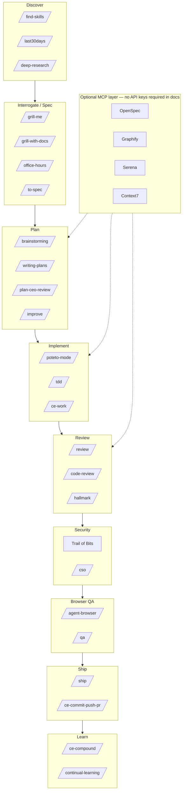

# Agent Skills — Super-Pro Developer Workflow

This repository ships a curated, project-local skill library under `.agents/skills/` so Cloud Agents and local Cursor sessions share the same workflows.

## 2026 architecture

Skills are organized into layers. Use one layer at a time — do not activate every methodology simultaneously.



| Layer | Purpose | Key skills |
| --- | --- | --- |
| **Discover** | Find the right skill or recent context | `/find-skills`, `/last30days`, `/deep-research`, `/improve quick` |
| **Interrogate / Spec** | Align requirements before coding | `/grill-me`, `/grill-with-docs`, `/office-hours`, `/to-spec` |
| **Plan** | Design and break down work | `/brainstorming`, `/writing-plans`, `/plan-ceo-review`, `/improve` |
| **Implement** | Build with rigor | `/poteto-mode`, `/tdd`, `/ce-work` |
| **Review** | Catch issues before merge | `/review`, `/code-review`, `/hallmark`, `/interrogate` |
| **Security** | Audit sensitive paths | Trail of Bits skills, `/cso`, `/semgrep` |
| **Browser QA** | Prove changes in the real app | `/qa`, `/agent-browser`, `/ce-test-browser` |
| **Ship** | Land the PR | `/ship`, `/ce-commit-push-pr`, `/ce-babysit-pr` |
| **Learn** | Compound knowledge for next time | `/ce-compound`, `/continual-learning` |

### Optional MCP layer

These tools extend skills with live context. They are **optional** — no API keys are required to use this repo's skill library.

| Tool | Role | When to enable |
| --- | --- | --- |
| [OpenSpec](https://github.com/Fission-AI/OpenSpec) | Spec-driven change proposals | Formal RFC-style changes across repos |
| [Graphify](https://github.com/Graphify-Labs/graphify) | Local tree-sitter code graph (used by gstack `/setup-gbrain`) | Offline code intelligence, no cloud index |
| [Serena](https://github.com/oraios/serena) | LSP-backed semantic analysis MCP | Deep symbol/type queries (Trail of Bits zeroize-audit) |
| [Context7](https://context7.com) | Up-to-date library docs via MCP | Framework doc lookups in `/ce-plan` researchers |

Enable MCP servers in Cursor Settings → MCP when you need them. Skills degrade gracefully when an MCP server is unavailable.

## Core 10 (daily driver)

These ten commands cover most non-trivial work:

1. `/find-skills` — discover the right skill for any task
2. `/poteto-mode` — rigorous engineering playbook (feature, bug-fix, refactor)
3. `/grill-with-docs` — align on requirements before coding
4. `/brainstorming` + `/writing-plans` — design exploration and implementation plans
5. `/tdd` — test-driven development for bug fixes
6. `/review` or `/interrogate` — code review before PR
7. `/agent-browser` or `/qa` — browser QA against the running app
8. `/ship` — land the PR with checks
9. `/ce-compound` — capture learnings after shipping
10. `/improve quick` — periodic codebase health audit

## Installed ecosystems

| Ecosystem | Source | Skills | Primary use |
| --- | --- | --- | --- |
| **pstack** | [cursor/plugins/pstack](https://github.com/cursor/plugins/tree/main/pstack) | 40+ | Rigorous engineering playbooks (`/poteto-mode`, `/how`, `/why`, `/tdd`) |
| **gstack** | [garrytan/gstack](https://github.com/garrytan/gstack) | 50+ | Virtual eng team: `/review`, `/qa`, `/ship`, `/office-hours` |
| **Superpowers** | [obra/superpowers](https://github.com/obra/superpowers) | 14 | TDD, brainstorming, plans, git worktrees, verification |
| **Matt Pocock** | [mattpocock/skills](https://github.com/mattpocock/skills) | 37 | `/grill-me`, `/triage`, `/implement`, `/to-spec`, `/code-review` |
| **improve** | [shadcn/improve](https://github.com/shadcn/improve) | 1 | Read-only codebase audit → executable plans in `plans/` |
| **Vercel** | [vercel-labs/agent-skills](https://github.com/vercel-labs/agent-skills) | 9 | React/Next best practices, deploy, web design guidelines |
| **Anthropic** | [anthropics/skills](https://github.com/anthropics/skills) | 20 | Frontend design, MCP builder, document skills, skill-creator |
| **Cloudflare** | [cloudflare/skills](https://github.com/cloudflare/skills) | 13 | Workers, Wrangler, Durable Objects, Agents SDK |
| **Stripe** | [stripe/ai](https://github.com/stripe/ai) | 8 | Payments integration best practices |
| **Trail of Bits** | [trailofbits/skills](https://github.com/trailofbits/skills) | 12 | Security review, vulnerability triage, static analysis |
| **Cursor plugins** | [cursor/plugins](https://github.com/cursor/plugins) | varies | team-kit, orchestrate, continual-learning, ralph-loop |

### Super-pro layer (installed)

| Ecosystem | Source | Skills added | Primary use |
| --- | --- | --- | --- |
| **find-skills** | [vercel-labs/skills](https://github.com/vercel-labs/skills) | 1 | Skill discovery across the registry |
| **agent-browser** | [vercel-labs/agent-browser](https://github.com/vercel-labs/agent-browser) | 1 | Headless browser automation for QA |
| **Compound Engineering** | [EveryInc/compound-engineering-plugin](https://github.com/EveryInc/compound-engineering-plugin) | 34 | Plan → work → review → ship → compound learnings |
| **Awesome Copilot** | [github/awesome-copilot](https://github.com/github/awesome-copilot) | 417 | Broad toolbox: specs, testing, Azure, GitHub, docs |
| **Microsoft** | [microsoft/skills](https://github.com/microsoft/skills) | 9 (selective) | MCP builder, docs, frontend review, issue creation |
| **Supabase** | [supabase/agent-skills](https://github.com/supabase/agent-skills) | 2 | Postgres best practices, Supabase patterns |
| **AWS Agent Toolkit** | [aws/agent-toolkit-for-aws](https://github.com/aws/agent-toolkit-for-aws) | 55 | Bedrock, CDK, IAM, serverless, security agents, data lake |
| **Spec Kit** | [github/spec-kit](https://github.com/github/spec-kit) | 10 | Spec-driven dev: `/speckit-specify`, `/speckit-plan`, `/speckit-implement` (in `.cursor/skills/`) |

### 2026 curated stack (selective)

| Skill | Source | Slash command | Primary use |
| --- | --- | --- | --- |
| **hallmark** | [nutlope/hallmark](https://github.com/nutlope/hallmark) | `/hallmark` | High-quality writing and content review |
| **last30days** | [mvanhorn/last30days-skill](https://github.com/mvanhorn/last30days-skill) | `/last30days` | Recent news and context for any topic |
| **deep-research** | [24601/agent-deep-research](https://github.com/24601/agent-deep-research) | `/deep-research` | Multi-step research with citations |
| **remotion-best-practices** | [remotion-dev/skills](https://github.com/remotion-dev/skills) | `/remotion-best-practices` | Programmatic video with Remotion |
| **NVIDIA (3 skills)** | [nvidia/skills](https://github.com/NVIDIA/skills) | `/data-designer`, `/cudaq-guide`, `/cuopt-numerical-optimization-api` | Data design, CUDA-Q, numerical optimization |

**Total:** 880+ skills in `.agents/skills/` plus 10 Spec Kit skills in `.cursor/skills/`.

> We deliberately do **not** install the full [microsoft/skills](https://github.com/microsoft/skills) (175+) or [wshobson](https://github.com/wshobson) plugin trees — install more on demand with `npx skills add`.

## Quick start

### 1. One-time project setup

```bash
# Install all curated skill packs (idempotent — safe to re-run)
./scripts/install-skills.sh
```

This script:
- Installs curated packs to `.agents/skills/` via `npx skills@latest add ... --agent cursor -y --copy`
- Runs `./scripts/sync-gstack-skills.sh` for gstack short slash-command folder names
- Skips full microsoft/skills and wshobson catalogs

Matt Pocock skills read from `docs/agents/issue-tracker.md`, `triage-labels.md`, and `domain.md`. pstack model overrides live in `~/.cursor/rules/pstack-models.mdc`.

### 2. Daily workflow commands

| When | Command |
| --- | --- |
| Find the right skill | `/find-skills <describe task>` |
| Recent context on a topic | `/last30days <topic>` |
| Deep research with citations | `/deep-research <question>` |
| Any non-trivial task | `/poteto-mode <describe the task>` |
| Need alignment before coding | `/grill-me` or `/grill-with-docs` |
| Audit codebase for improvements | `/improve` or `/improve quick` |
| Plan a feature rigorously | `/brainstorming` then `/writing-plans` |
| Code review before PR | `/review` (gstack) or `/interrogate` (pstack) |
| Writing quality pass | `/hallmark` |
| Browser QA | `/agent-browser` or `/qa https://localhost:3000` |
| Ship with QA | `/ship` or `/ce-commit-push-pr` |
| Debug systematically | `/systematic-debugging` or `/poteto-mode` bug-fix playbook |
| TDD bug fix | `/tdd` |
| Capture learnings | `/ce-compound` |

### 3. Recommended stacks by task

**Feature development**
1. `/find-skills` — pick the right workflow
2. `/grill-with-docs` — align on requirements
3. `/brainstorming` — design exploration (Superpowers)
4. `/poteto-mode` feature playbook — implement with rigor
5. `/review` — gstack code review
6. `/agent-browser` — browser QA
7. `/ship` — land the PR
8. `/ce-compound` — capture learnings

**Codebase health**
1. `/improve quick` — audit and prioritize
2. Pick findings → plans land in `plans/`
3. `/improve execute 001` — dispatch executor

**Ledger Atlas (this repo)**
```bash
npm ci
npm run dev          # http://localhost:3000
npm test
npm run typecheck
npm run lint
npm run build
```

## Install / update skills

### Recommended: idempotent installer

```bash
./scripts/install-skills.sh
```

### Manual installs

Skills are managed with the [skills CLI](https://github.com/vercel-labs/skills):

```bash
# Skill discovery (install first in any new repo)
npx skills add vercel-labs/skills --skill find-skills --agent cursor -y --copy

# 2026 curated stack
npx skills add nutlope/hallmark --skill hallmark --agent cursor -y --copy
npx skills add mvanhorn/last30days-skill --skill last30days --agent cursor -y --copy
npx skills add 24601/agent-deep-research --skill deep-research --agent cursor -y --copy
npx skills add remotion-dev/skills --skill remotion-best-practices --agent cursor -y --copy
npx skills add nvidia/skills \
  --skill data-designer cudaq-guide cuopt-numerical-optimization-api \
  --agent cursor -y --copy

# Compound engineering lifecycle
npx skills add EveryInc/compound-engineering-plugin --agent cursor -y --copy

# Microsoft (selective — avoid installing all 175+)
npx skills add microsoft/skills \
  --skill skill-creator mcp-builder github-issue-creator \
  --skill frontend-design-review microsoft-docs \
  --agent cursor -y --copy

# List installed
npx skills list

# Update all
npx skills update -y

# Search the registry
npx skills find "react performance"
```

Browse the public index at [skills.sh](https://skills.sh).

### gstack (virtual eng team)

gstack's `./setup --host cursor` installs skills under `~/.cursor/skills/gstack-*` (prefixed folder names). Slash commands like `/plan-ceo-review` and `/review` need **short folder names** (`plan-ceo-review/`, `review/`, …). Cloud Agents only load project `.agents/skills/` — not global `~/.cursor/skills/`.

After cloning or updating the vendor repo:

```bash
# One-time / refresh — copies 54 skills with short names to .agents/skills/
./scripts/sync-gstack-skills.sh
```

Or run the full installer which calls sync automatically:

```bash
./scripts/install-skills.sh
```

Vendor clone (gitignored): `vendor/skills-repos/gstack`. Runtime binaries live under `.agents/skills/gstack/` (symlinks into the vendor tree).

**Key slash commands:**

| Command | Purpose |
| --- | --- |
| `/office-hours` | Product interrogation — start here for new ideas |
| `/plan-ceo-review` | CEO/founder strategic plan review |
| `/plan-eng-review` | Engineering architecture plan review |
| `/plan-design-review` | Design plan review |
| `/review` | Pre-landing PR / diff review |
| `/qa` | Browser QA on a staging URL |
| `/ship` | Land the PR with checks |
| `/investigate` | Root-cause debugging |
| `/autoplan` | End-to-end planning workflow |
| `/cso` | Security audit (OWASP + STRIDE) |
| `/gstack-upgrade` | Update gstack install |

Note: `--host cursor` does not apply `--no-prefix` today (generated `.cursor/skills/gstack-*` trees keep the prefix). Use `sync-gstack-skills.sh` for short names in this repo.

If another skill already owns a name (e.g. this repo's session `/retro` from continual-learning), the sync script skips the gstack skill and prints a warning.

## Project agent configuration

Matt Pocock skills read from:

| File | Purpose |
| --- | --- |
| `docs/agents/issue-tracker.md` | GitHub Issues on `praxstack/ledger-atlas` |
| `docs/agents/triage-labels.md` | Default five-role triage vocabulary |
| `docs/agents/domain.md` | Single-context domain doc layout |
| `CLAUDE.md` | Agent skills summary block |

pstack model overrides: `~/.cursor/rules/pstack-models.mdc`

### Verification skill (optional)

For project-local browser verification harnesses, run `/create-verification-skill` after setup. This generates a `verify-*` skill tailored to the app's real UI flows.

## Directory layout

```
.agents/skills/          # Project skills (committed — works in Cloud Agents)
  find-skills/
  agent-browser/
  poteto-mode/
  review/                # gstack short name
  ship/
  hallmark/
  last30days/
  deep-research/
  ...
scripts/
  install-skills.sh      # Idempotent curated installer
  sync-gstack-skills.sh  # gstack short-name sync
.cursor/skills/          # Spec Kit workflow skills (speckit-*)
.specify/                # Spec Kit templates, scripts, constitution
docs/agents/             # Per-repo agent configuration
vendor/skills-repos/     # Git clones for reference (gitignored)
.cursor/environment.json # Cloud Agent environment config
CLAUDE.md                # Agent skills entry point
```

## Notes

- Project skills in `.agents/skills/` are loaded by Cursor automatically ([docs](https://cursor.com/docs/skills)).
- Global skills in `~/.cursor/skills/` are **not** copied to Cloud Agents — keep workflows in the repo (run `./scripts/install-skills.sh` or `./scripts/sync-gstack-skills.sh`).
- Slash commands resolve from **folder names** under `.agents/skills/`, not just frontmatter `name:`.
- `agent-browser` CLI: install with `npm install -g agent-browser --prefix ~/.npm-global` then `agent-browser install`.
- gstack's browse binary is installed globally; browser QA skills need Playwright/Chrome.
- Review skill security assessments at [skills.sh](https://skills.sh) before enabling in sensitive repos.
- ESLint ignores `.agents/**` and `vendor/**` — `npm run lint` only checks app source.
