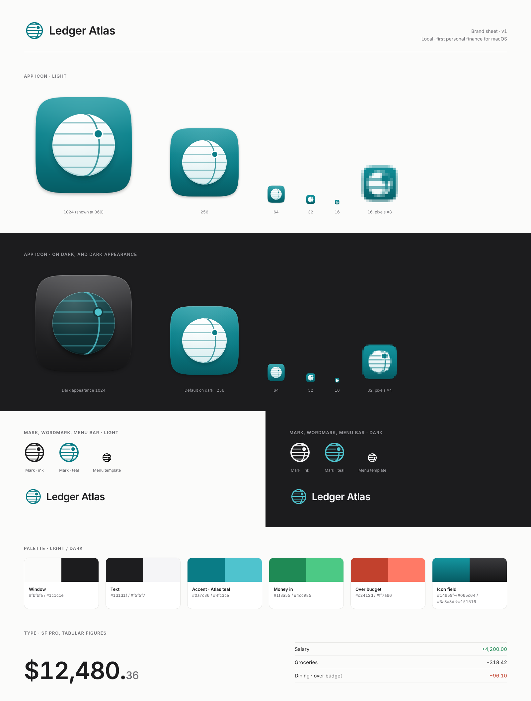

# Ledger Atlas brand

Source for the sheet: [`brand-sheet.html`](brand-sheet.html). Assets live in [`Assets/Brand`](../../Assets/Brand).

## Name

- Always **Ledger Atlas**: two words, both capitalised, never "LedgerAtlas", "Ledger-Atlas" or "LA".
- A ledger is the exact record. An atlas is the map of the whole. The product keeps both.
- In running text the name needs no ™ or styling. Don't put the name inside the icon.

## The mark

A globe seen edge-on. In that view the parallels are straight, evenly spaced lines, which are also the ruled lines of a ledger page. One meridian curves through them, and one solid dot sits where the meridian crosses a rule: **every entry has a place on the map**. There's no chart line, no coin, no arrow. The mark promises precision and orientation, not growth.

| File | Use |
| --- | --- |
| `ledger-atlas-app-icon.svg` | App icon master, 1024 canvas, 824 macOS icon grid. Use at 64 px and up. |
| `ledger-atlas-app-icon-32.svg`, `-16.svg` | Pixel-hinted versions for 32 px and 16 px renders only. |
| `ledger-atlas-app-icon-dark.svg` | Dark appearance: graphite field, smoked glass globe. |
| `ledger-atlas-mark.svg` | One-colour mark for the sidebar header, welcome screen and docs. Safe to tint. |
| `ledger-atlas-menu-icon.svg` | Menu bar template image: black on transparent, so macOS tints it. |
| `ledger-atlas-wordmark.svg`, `-dark.svg` | Mark plus name, for light and dark grounds. |

**Clear space.** Leave space equal to the dot's halo diameter (¼ of the mark's width) on every side. The wordmark's gap between mark and name is fixed. Don't change it.

**Minimum size.** App icon: 16 px (use the hinted SVG). Mark: 14 pt on screen, 6 mm in print. Wordmark: 96 px wide.

**Rebuilding the app icon set.** Render each `AppIcon.appiconset` size from the master, using `-16.svg` for 16 px and `-32.svg` for 32 px, at exactly the pixel sizes `Contents.json` lists.

## Colour

| Role | Light | Dark |
| --- | --- | --- |
| Window | `#fbfbfa` | `#1c1c1e` |
| Text | `#1d1d1f` | `#f5f5f7` |
| Accent, Atlas teal (the only accent) | `#0a7c86` | `#4fc3ce` |
| Money in | `#1f8a55` | `#4cc985` |
| Over budget | `#c2412d` | `#ff7a66` |
| Icon field (gradient, icon only) | `#14959f` → `#0a7c86` → `#065c64` | `#3a3a3d` → `#232325` → `#151516` |
| Icon glass globe (icon only) | `#ffffff` → `#d9eef0` | `#1f4c51` → `#0e2c30` |

Green and red only ever mean money in and over budget. They're never decoration.

## Typography

- **SF Pro** (the system font) everywhere. Use **SF Pro Display** at 20 pt and above, and SF Pro Text below.
- Numbers are the hero. Always use **tabular figures** (`.monospacedDigit()` in SwiftUI) so columns line up and totals don't jitter.
- Wordmark: SF Pro Display Semibold (600), tracking −0.02 em.
- Use weights 400, 500 and 600. Don't use bold for emphasis in body text.

## Voice

- **Plain.** Say "You spent $318 on groceries", not "Your grocery expenditure trended upward".
- **Exact.** Give real numbers, dates and sources. Never round without saying so.
- **Calm.** Don't use exclamation marks, alarms or streaks. Over budget is a fact, not an emergency.
- **Private.** Your data stays on your Mac, and we say so whenever it matters.

## Do / don't

| Do | Don't |
| --- | --- |
| Use the mark in one colour: ink, teal or white | Recolour the globe in green or red |
| Keep glass for the floating sidebar and toolbar | Put the icon's glass effect behind content |
| Use the hinted icons at 16 and 32 px | Scale the 1024 master down to 16 px |
| Let numbers lead, in tabular figures | Add charts, coins or arrows to the mark |
| Give the mark its clear space | Put the name or any text inside the app icon |
| Use the menu template as-is | Add colour to the menu bar icon |
