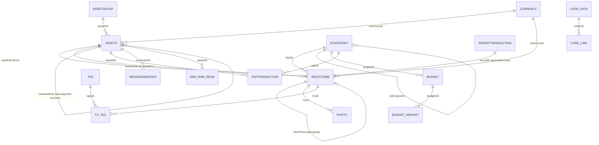

# Money Manager Android v19: schema contract

Status: frozen input contract. Ledger Atlas must always be able to read a backup
that matches this file, whatever the canonical ledger becomes.
Updated: 2026-11-01.

The exact DDL is in [`money-manager-android-v19.schema.sql`](money-manager-android-v19.schema.sql).
[`scripts/mm_v19_contract_check.py`](../../scripts/mm_v19_contract_check.py) checks any
backup against it and prints counts only.

## Why this file exists

Ledger Atlas will change its own schema many times (it is at canonical v11 today).
Money Manager's schema is not ours and will not change to suit us. The only way to stay
backward compatible forever is to freeze what we know about the vendor format in one
place, test against it, and keep every vendor term inside the v19 adapter.

```text
Money Manager backup (.mmbak / .sqlite, v19)   <- frozen here, never changes
        │  read-only, immutable, hashed
        ▼
v19 adapter (MMImport)                          <- the only code that knows these names
        │  mapped, sidecar, excluded, or blocking (LossReport)
        ▼
Canonical ledger (LedgerStore, schema v11 → vN) <- free to evolve
```

Rule: a new canonical schema version may never require a change to this file. If a
newer Money Manager release changes the backup, that is a new source profile with its
own contract file, not an edit to this one.

## Evidence

| Snapshot | Date | Schema | Notes |
|---|---|---|---|
| Android `.mmbak` + `.sqlite` pair | 2026-08-10 | v19, 19 tables | Recorded in the research repo, wave 3 |
| Android `.mmbak` + `.sqlite` pair | 2026-11-01 | v19, 19 tables, identical DDL | Byte-identical pair; `.mmbak` is plain SQLite |

Both snapshots pass `PRAGMA integrity_check`. Between them only row counts changed, so
the schema has been stable across at least 12 weeks of real use.

Labels used below: **observed** (seen in the data), **inferred** (strongly suggested by
the data, not confirmed in the app), **unknown**.

## Container and header

- A `.mmbak` from Android is a plain SQLite 3 file, not a ZIP (observed). Detect by the
  16-byte magic `SQLite format 3\0`, never by file extension.
- `PRAGMA user_version = 19`, page size 4096, UTF-8, `application_id = 0` (observed).
- No foreign keys, triggers, or views. Relationships are by text `uid` and must be
  reconciled by the importer (observed).
- `android_metadata.locale` holds the device locale string (observed).

## Entity map



Every table also carries `isSynced`, `syncTime`, `syncVersion` (vendor cloud-sync
bookkeeping). They carry no financial meaning but must be preserved as sidecars.

## Tables

### INOUTCOME: transactions (the core table)

| Column | Storage | Meaning | Label |
|---|---|---|---|
| `AID` | INTEGER PK | Local row id, not stable across devices | observed |
| `uid` | TEXT | Stable id. A UUID for hand-entered rows; `<repeatUid>_<YYYY-MM-DD>_<n>` for rows generated by a recurring rule | observed |
| `DO_TYPE` | **TEXT** here (INTEGER in other tables) | `0` income, `1` expense, `3` transfer out, `4` transfer in, `7` balance increase not counted as income, `8` balance decrease not counted as expense | all observed (7 and 8 on the 2026-11-02 test backup, see below) |
| `ZMONEY` | TEXT | Amount as a decimal string, always non-negative. Sign comes from `DO_TYPE`. A few values carry binary-float noise (up to 16 fraction digits) | observed |
| `IN_ZMONEY` | TEXT | Equal to `ZMONEY` in every observed row | observed |
| `AMOUNT_ACCOUNT` | REAL | The same amount as a float. Never use it for money; keep it as a sidecar | observed |
| `ZDATE` | TEXT | Instant in Unix epoch **milliseconds**, 13 digits | observed |
| `WDATE` | TEXT | Local calendar date `YYYY-MM-DD` in the device time zone at entry time | observed |
| `UTIME` | INTEGER | Last-modified instant, epoch ms. Can be earlier than `ZDATE` for future-dated rows | observed |
| `assetUid` | TEXT | Account the row belongs to | observed |
| `toAssetUid` | TEXT | Other account of a transfer. `NULL` or `''` otherwise | observed |
| `txUidTrans` | TEXT | Group id shared by the two legs of one transfer. It is **not** the uid of the other leg | observed |
| `txUidFee` | TEXT | Link from a transfer leg to a fee row. Set on one transfer pair only, and its target does not exist. The owner has never seen a transfer-fee feature in the app. The app rewrites `NULL` to `''` when a row is edited and saved, so treat both as "no fee". Preserve as a sidecar | observed, legacy |
| `ctgUid` | TEXT | Category. `NULL` or `''` on transfers. `-4` is a built-in "Balance Modification" category that has no `ZCATEGORY` row | observed |
| `currencyUid` | TEXT | Currency of the row | observed |
| `ZCONTENT` | TEXT | Short note shown in lists (user text) | observed |
| `ZDATA` | TEXT | Long description, shown as "Description" (user text, up to several KB, may hold emoji and newlines) | observed |
| `CARDDIVIDMONTH` | TEXT | `0` on hand-entered rows. On recurrence-generated rows it equals the rule's `REPEAT_TYPE`. On installment rows it is `10001` | observed |
| `CARD_DIVIDE_MONTH_STR`, `cardDivideUid` | TEXT | Installments: an N-month plan is written at save time as N rows, one per month on the same day and time, each `ZMONEY` = total / N. They share `cardDivideUid`; `CARD_DIVIDE_MONTH_STR` is `(k/N)`. The app's XLSX export appends it to the note | observed |
| `ASSET_NIC`, `CATEGORY_NAME` | TEXT | Denormalized account and category names copied at entry time, set on a few newer rows | observed |
| `IS_DEL`, `MARK` | INTEGER | `NULL` on older synced rows, `0` on newer rows. `NULL` does **not** mean deleted. Deleted transactions are removed, not flagged | observed |
| `SMS_ORIGIN`, `SMS_PARSE_CONTENT`, `SMS_RDATE` | TEXT | Bank SMS auto-entry data (private) | observed |
| `wtime`, `paid`, `lat`, `lng`, `gstd` | TEXT | Empty in every observed row | unknown |

Transfer shape (observed in every pair of both snapshots): one `3` row and one `4` row
share `txUidTrans`, with equal `ZMONEY` and `WDATE`, and swapped `assetUid` /
`toAssetUid`. `ZDATE` can differ by milliseconds between the two legs (6 of 426 pairs, by
1 ms). One pair in the 2026-11-01 backup names the same account on both legs.

Balance modification (observed on the 2026-11-02 test backup with screenshots). When
the user edits an account balance, the app asks whether to record the difference as
income (balance up) or expense (balance down). Every resulting row uses the built-in
category `-4`, which has no `ZCATEGORY` row (note "Difference", stats label "Modified
Bal."):

| Change | Answer | Row | Counts in income/expense totals |
|---|---|---|---|
| Up | Yes | `DO_TYPE=0`, `-4` | yes, as income |
| Down | Yes | `DO_TYPE=1`, `-4` | yes, as expense |
| Up | No | `DO_TYPE=7`, `-4` | no |
| Down | No | `DO_TYPE=8`, `-4` | no |

Proof: the app's monthly income and expense totals for May to Nov 2026 equal the sums of
type `0` and type `1` rows exactly, so types 3, 4, 7 and 8 are excluded. The Accounts
screen's assets, liabilities and every per-account balance reconcile to the paisa only
when type 7 adds money and type 8 subtracts it. The app's XLSX export omits types 7 and
8 entirely, so the XLSX is lossy and the backup is the only source of truth.

Import mapping: type `0` → income, `1` → expense, `7` → `adjustment` (adds money),
`8` → `adjustment_debit` (removes money). Types 7 and 8 are admitted only with category
`-4`; with any other category they stay preserved and flagged.

Transfers: type `3` → `transfer_debit`, `4` → `transfer_credit`, admitted only with an
empty or `NULL` category. The two legs of one `txUidTrans` group become one row of
`economic_event_transfer` (canonical v12). Its `transfer_id` is the SHA-256 of
length-prefixed `("mm-transfer", debit_event_id, credit_event_id)`, so a reimport writes
the same row. The ledger shows each pair as one transfer, dated by the debit leg. Two
cases stay preserved as source records instead:
- A group that is not exactly one `3` leg plus one `4` leg, or a leg with no group id.
  It is flagged `transfer_direction_unproven` and blocks lossless certification.
- A same-account pair. It moves no money; it is flagged `sameAccountTransfer` and does
  not block certification.

Time zone (observed): in both snapshots, every `WDATE` equals the local date of `ZDATE`
at UTC+05:30. The importer must not assume this offset; it should derive and confirm
the offset per backup (the checker reports every offset consistent with all rows).
The importer reads `ZDATE` as the UTC instant and derives the wall time in the chosen
source time zone; the derived day must equal `WDATE`. Reading `ZDATE` as a local
wall-clock epoch fails for 1,231 of 7,393 real rows (entries made 00:00–05:29 IST).
Replay still accepts events written by earlier builds that used that reading.

### ASSETS: accounts

Balances (observed): balance = +type 0, −type 1, −type 3, +type 4, +type 7, −type 8.
A Debit Card account (its group's `TYPE` is 3) has no balance of its own: its rows move the
account named in `cardAssetUid`. A credit card (group `TYPE` 2) also names its paying account
there, but its rows stay on the card. Rows of deleted accounts still count in income/expense
totals.

| Column | Meaning | Label |
|---|---|---|
| `uid` | Small integers (`1`, `2`, ...) for seeded accounts, UUID-like text for user accounts | observed |
| `NIC_NAME` | Account name (private) | observed |
| `groupUid` | `ASSETGROUP.uid` | observed |
| `currencyUid` | `CURRENCY.uid` | observed |
| `ZDATA` | `0` = shown on the Accounts screen (matches the screen list exactly), `1` = deleted (accounts created and then deleted in the test session have `1`), `3` = not shown, likely hidden | 0/1 observed, 3 inferred |
| `ZDATA1` | Free text (account memo), often empty | observed |
| `ZDATA2` | `1` = "Include in totals" off: shown grey and left out of group and screen totals | observed |
| `IS_TRANS_EXPENSE` | `0` or `1`: count transfers into this account as expense | inferred from name |
| `CARD_DAY_FIN`, `CARD_DAY_PAY` | Card statement closing day and payment day | inferred from name |
| `cardAssetUid` | Account that pays this card | observed |
| `IS_CARD_AUTO_PAY`, `CARD_USAGE_HURDLE_*` | Card options, defaults in every observed row | unknown |
| `APP_PACKAGE`, `APP_NAME`, `SMS_TEL`, `SMS_STRING` | SMS/notification parser binding | observed (empty) |
| `ORDERSEQ`, `A_UTIME` | Display order, last-modified ms | observed |

### ASSETGROUP: account groups

`TYPE` takes values 1 to 11, one group per type, and `ACC_GROUP_NAME` names each one
(observed, default English names): 1 Accounts, 2 Card, 3 Debit Card, 4 Savings, 5 Loan,
6 Top-Up/Prepaid, 7 Others, 8 Investments, 9 Overdrafts, 10 Insurance, 11 Cash. The
name is user-editable, so map behavior by `TYPE` and keep the name as display text.

### ZCATEGORY: categories

| Column | Meaning | Label |
|---|---|---|
| `uid` | Small integers for seeded categories, UUID-like text for user ones | observed |
| `TYPE` | `0` income, `1` expense (matches the `DO_TYPE` of every transaction that uses it) | observed |
| `pUid` | Parent `uid`. `NULL`, `''`, or `0` means a top-level category. Every observed tree is exactly two levels (parent, child) | observed |
| `STATUS` | `0` on top-level rows, `2` on child rows in every observed row | inferred |
| `C_IS_DEL` | `1` deleted, `0` live, `NULL` on a few seeded rows. Transactions can still point at deleted categories, and must keep them | observed |
| `NAME`, `ORDERSEQ`, `C_UTIME` | Name (private), order, modified ms | observed |

### CURRENCY

One row in both snapshots (main currency). `RATE` is REAL; `DECIMAL_POINT` gives display
precision (2 observed); `SYMBOL_POSITION` (`P` observed) and `INSERT_TYPE` (`I`
observed) are display options. Multi-currency backups are **unknown**: no fixture.

### REPEATTRANSACTION: recurring rules

The app offers 14 choices: Nothing, Every Day, Weekdays, Weekend, Every Week, Every 2
weeks, Every 4 weeks, Every Month, The end of the month, Every 2/3/4/6 Month, Annually.
Observed codes: `1` = Every Month, `5` = Every Day, `7` = Every 2 weeks, `10` = Weekend,
`17` = Annually (`NEXT_DATE` exactly one year after the generated row). The other codes are
**unknown**: an unknown code must block that rule, never guess a period. Generated rows
get `ZDATE` = local midnight of the due day. `NEXT_DATE` is epoch ms; `END_DATE = 0` means no end (observed in every row).
Generated transactions use the rule `uid` as the prefix of their own `uid`. Some
generated rows point at rules that no longer exist: keep them as plain transactions.

Import mapping: a live or deleted rule becomes a Ledger Atlas recurring rule only when it can
be expressed exactly, meaning all of the following hold:
- the code is 1, 5, 7 or 17
- `DO_TYPE` is 0 or 1
- there is no `toAssetUid`
- `END_DATE = 0`
- the account resolves
- the currency matches the account
- `AMOUNT_SUB` is the nearest binary64 to a two-decimal literal

The rule starts on the local day of `NEXT_DATE`, so rows Money Manager already generated
are not generated again. Any other rule, including Weekend (10), stays byte-preserved and
never blocks the import. Observed real backup: 10 rules (8 monthly, 2 annual, all expense,
clean two-decimal amounts), so all 10 map.

### PHOTO: receipt attachments

Rows hold metadata only (`FILE_PATH`, `FILE_NAME`, `ORG_FILE_*`, `FILE_SIZE`); the image
bytes are not in the backup. `txUid` links to `INOUTCOME.uid`; a transaction can have up
to 5 photos. Every photo whose transaction is gone is marked `IS_DEL = 1` (observed).
Paths are device paths and private.

### BUDGET and BUDGET_AMOUNT

`BUDGET.targetUid` points at a category; `BUDGET_AMOUNT.budgetUid` holds the amount as
REAL. Budget uid = `<targetUid>_<DO_TYPE>_<IS_TOTAL>_<TRANSFER_TYPE>_<PERIOD_TYPE>`; amount
uid = budget uid + `_<BUDGET_PERIOD>`. `BUDGET_PERIOD = 0` is the default amount and
`YYYYMM` rows override one month. `PERIOD_TYPE = 6` is the only value seen and pairs with
monthly overrides, so it is very likely monthly (inferred; see
`docs/decisions/0008-budget-period-6.md`). Months follow the app's "Monthly Start Date"
setting (the 25th in the observed backup), not calendar months.

### ZETC: app settings

Key/value rows: `ZDATATYPE` is a numeric key (some negative, one looks like a date),
`ZDATA` the value. One key holds `25`, matching the "Monthly Start Date: Every 25" setting
(inferred). Observed keys are app preferences and one list of language codes.
Preserve all rows as sidecars; none is financial truth.

### TAG and TX_TAG, FAVTRANSACTION, MEMO, CODE_DATA, CODE_LINK, MESSAGEMACRO2, SMS_RAW_READ

`TAG` has rows but `TX_TAG` is empty in both snapshots, so tag links are untested.
`FAVTRANSACTION` holds saved templates (`AMOUNT_SUB` is REAL). `MEMO`, `CODE_DATA`,
`CODE_LINK`, `MESSAGEMACRO2`, and `SMS_RAW_READ` are empty in both snapshots. Their
shapes are known from the DDL only, so any future rows must go to sidecars and be
reported, never dropped.

## Compatibility rules for Ledger Atlas

1. Accept by content: SQLite magic, `user_version = 19`, every contract table and
   column present. Extra columns or tables are additive drift: import, but preserve
   them as sidecars and say so in the LossReport.
2. A missing contract column or table is a different profile. Refuse it with a clear
   reason; never guess.
3. Read amounts from `ZMONEY` as text into `ExactDecimal`. Keep the raw literal. Never
   read `AMOUNT_ACCOUNT` or any REAL money column as truth.
4. Read time from `ZDATE` (instant) plus `WDATE` (local date). Keep both raw literals.
5. Treat `NULL`, `''`, and `0` as distinct raw values, even where they mean the same
   thing today (`pUid`, `IS_DEL`, `toAssetUid`).
6. Keep every `uid` exactly as text. Small integer uids are valid.
7. Map transfers per `txUidTrans` group, not per row. A group that is not exactly one
   `3` leg plus one `4` leg stays preserved and blocks lossless certification.
8. Map balance edits as the table above says. Preserve and flag: `txUidFee`, `CARDDIVIDMONTH`, budgets,
   recurring rules, photos, settings, and sync columns. Each gets a LossReport line.
   Every staged field must land in the canonical store as a binding, an event sidecar, or a
   receipt-owned preservation payload with identical bytes; the full-schema import test
   checks this for photos (paths only), recurring rules, and drift columns and tables.
9. Fixtures in Git are synthetic only, built from the DDL file. Real backups stay
   outside the repo (see `EVIDENCE.md`).
10. Book a Debit Card account's entries, transfer legs and recurring rules on the account
    its `cardAssetUid` names, when that is another existing account (#207). The card is
    still imported, with no entries of its own. The entry's account proof is then the
    card's `ASSETS.cardAssetUid` field, not the row's `assetUid`; replay checks that the
    row's `assetUid` names that card and that the card's group has `TYPE` 3. The row's own
    `assetUid` stays retained byte-exact. Ledgers imported before #207 keep the row's
    `assetUid` as proof and still verify. A debit card naming no existing account keeps
    its entries, and the balance receipt says so. A transfer between a debit card and the
    account that pays it moves no money and stays preserved, like any same-account pair.

## Open questions (need the Money Manager app as an oracle)

- Codes for the 9 repeat schedules not yet seen (one test rule each settles them).
- `PERIOD_TYPE` values other than 6 (the budget period picker was not captured).
- `ASSETS.ZDATA = 3`.
- A transfer with a fee (no transfer was made in the test session).
- Multi-currency rows, tag links, memos, and iOS backups (no fixture yet).

## Checking a backup

```sh
python3 -I scripts/mm_v19_contract_check.py /path/to/backup.mmbak --json
```

Exit 0 compatible, 1 additive drift, 2 breaking, 3 not SQLite or not v19. The source
is opened with `mode=ro&immutable=1` and hashed before and after.

To certify a whole import (bytes, profile, adapter, locale, oracle and level), use
`mmctl certify`; see `money-manager-v19-import-certificate.md`.
