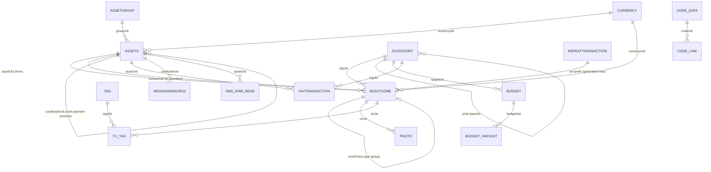

# Money Manager Android v19: schema contract

Status: frozen input contract. Ledger Atlas must always be able to read a backup
that matches this file, whatever the canonical ledger becomes.
Updated: 2026-11-01.

The exact DDL is in [`money-manager-android-v19.schema.sql`](money-manager-android-v19.schema.sql).
[`scripts/mm_v19_contract_check.py`](../../scripts/mm_v19_contract_check.py) checks any
backup against it and prints counts only.

## Why this file exists

Ledger Atlas will change its own schema many times (it is at canonical v11 today).
Money Manager's schema is not ours and will not change to suit us. The only way to stay
backward compatible forever is to freeze what we know about the vendor format in one
place, test against it, and keep every vendor term inside the v19 adapter.

```text
Money Manager backup (.mmbak / .sqlite, v19)   <- frozen here, never changes
        │  read-only, immutable, hashed
        ▼
v19 adapter (MMImport)                          <- the only code that knows these names
        │  mapped, sidecar, excluded, or blocking (LossReport)
        ▼
Canonical ledger (LedgerStore, schema v11 → vN) <- free to evolve
```

Rule: a new canonical schema version may never require a change to this file. If a
newer Money Manager release changes the backup, that is a new source profile with its
own contract file, not an edit to this one.

## Evidence

| Snapshot | Date | Schema | Notes |
|---|---|---|---|
| Android `.mmbak` + `.sqlite` pair | 2026-08-10 | v19, 19 tables | Recorded in the research repo, wave 3 |
| Android `.mmbak` + `.sqlite` pair | 2026-11-01 | v19, 19 tables, identical DDL | Byte-identical pair; `.mmbak` is plain SQLite |

Both snapshots pass `PRAGMA integrity_check`. Between them only row counts changed, so
the schema has been stable across at least 12 weeks of real use.

Labels used below: **observed** (seen in the data), **inferred** (strongly suggested by
the data, not confirmed in the app), **unknown**.

## Container and header

- A `.mmbak` from Android is a plain SQLite 3 file, not a ZIP (observed). Detect by the
  16-byte magic `SQLite format 3\0`, never by file extension.
- `PRAGMA user_version = 19`, page size 4096, UTF-8, `application_id = 0` (observed).
- No foreign keys, triggers, or views. Relationships are by text `uid` and must be
  reconciled by the importer (observed).
- `android_metadata.locale` holds the device locale string (observed).

## Entity map



Every table also carries `isSynced`, `syncTime`, `syncVersion` (vendor cloud-sync
bookkeeping). They carry no financial meaning but must be preserved as sidecars.

## Tables

### INOUTCOME: transactions (the core table)

| Column | Storage | Meaning | Label |
|---|---|---|---|
| `AID` | INTEGER PK | Local row id, not stable across devices | observed |
| `uid` | TEXT | Stable id. A UUID for hand-entered rows; `<repeatUid>_<YYYY-MM-DD>_<n>` for rows generated by a recurring rule | observed |
| `DO_TYPE` | **TEXT** here (INTEGER in other tables) | `0` income, `1` expense, `3` transfer out, `4` transfer in, `7` balance decrease from a balance edit | 0/1 observed; 3/4 observed by pairing; 7 owner-described, see below |
| `ZMONEY` | TEXT | Amount as a decimal string, always non-negative. Sign comes from `DO_TYPE`. A few values carry binary-float noise (up to 16 fraction digits) | observed |
| `IN_ZMONEY` | TEXT | Equal to `ZMONEY` in every observed row | observed |
| `AMOUNT_ACCOUNT` | REAL | The same amount as a float. Never use it for money; keep it as a sidecar | observed |
| `ZDATE` | TEXT | Instant in Unix epoch **milliseconds**, 13 digits | observed |
| `WDATE` | TEXT | Local calendar date `YYYY-MM-DD` in the device time zone at entry time | observed |
| `UTIME` | INTEGER | Last-modified instant, epoch ms. Can be earlier than `ZDATE` for future-dated rows | observed |
| `assetUid` | TEXT | Account the row belongs to | observed |
| `toAssetUid` | TEXT | Other account of a transfer. `NULL` or `''` otherwise | observed |
| `txUidTrans` | TEXT | Group id shared by the two legs of one transfer. It is **not** the uid of the other leg | observed |
| `txUidFee` | TEXT | Link from a transfer leg to a fee row. Set on one transfer pair only, and its target does not exist. The owner has never seen a transfer-fee feature in the app. Preserve as a sidecar | observed, legacy |
| `ctgUid` | TEXT | Category. `NULL` or `''` on transfers. `-4` is a built-in "Balance Modification" category that has no `ZCATEGORY` row | observed |
| `currencyUid` | TEXT | Currency of the row | observed |
| `ZCONTENT` | TEXT | Short note shown in lists (user text) | observed |
| `ZDATA` | TEXT | Long description (user text, up to several KB, may hold emoji and newlines) | observed |
| `CARDDIVIDMONTH` | TEXT | `0` on hand-entered rows. On recurrence-generated rows it equals the rule's `REPEAT_TYPE`. Despite the name, not an installment count in any observed row | inferred |
| `CARD_DIVIDE_MONTH_STR`, `cardDivideUid` | TEXT | Installment fields; empty in every observed row | unknown |
| `ASSET_NIC`, `CATEGORY_NAME` | TEXT | Denormalized account and category names copied at entry time, set on a few newer rows | observed |
| `IS_DEL`, `MARK` | INTEGER | `NULL` on older synced rows, `0` on newer rows. `NULL` does **not** mean deleted. Deleted transactions are removed, not flagged | observed |
| `SMS_ORIGIN`, `SMS_PARSE_CONTENT`, `SMS_RDATE` | TEXT | Bank SMS auto-entry data (private) | observed |
| `wtime`, `paid`, `lat`, `lng`, `gstd` | TEXT | Empty in every observed row | unknown |

Transfer shape (observed in every pair of both snapshots): one `3` row and one `4` row
share `txUidTrans`, with equal `ZMONEY` and `WDATE`, and swapped `assetUid` /
`toAssetUid`. `ZDATE` can differ by milliseconds between the two legs. The importer
should map each pair to one canonical transfer, and treat a lone leg as blocking.

Balance modification: when the user edits an account balance, the app records the
difference as a new entry in category `-4` (shown as "Difference"; the denormalized name
on some rows reads "Balance Modification"). The owner confirmed on 2026-11-01 that a
lower balance shows as an expense and a higher one as income. The data matches that
split: every increase is a `DO_TYPE=0` row with category `-4`, and no `DO_TYPE=1` row
uses `-4`, so `DO_TYPE=7` is the decrease (outflow). Label: owner-observed plus data
consistency; one test backup with a known decrease would make it observed. Until then
type 7 maps as an outflow only behind that confirmation (see
`docs/decisions/0007-type-7.md`).

Time zone (observed): in both snapshots, every `WDATE` equals the local date of `ZDATE`
at UTC+05:30. The importer must not assume this offset; it should derive and confirm
the offset per backup (the checker reports every offset consistent with all rows).

### ASSETS: accounts

| Column | Meaning | Label |
|---|---|---|
| `uid` | Small integers (`1`, `2`, ...) for seeded accounts, UUID-like text for user accounts | observed |
| `NIC_NAME` | Account name (private) | observed |
| `groupUid` | `ASSETGROUP.uid` | observed |
| `currencyUid` | `CURRENCY.uid` | observed |
| `ZDATA` | Likely visibility: `0` = shown, `1` or `3` = hidden or closed. The owner's visible counts for Card (10), Savings (2), Investments (28), Others (2) and Cash (2) equal the `ZDATA = 0` rows; every Loan and Accounts-group row is non-zero | inferred |
| `ZDATA1` | Free text (account memo), often empty | observed |
| `ZDATA2` | `0` or `1` | unknown (possibly "hide" or "exclude from totals") |
| `IS_TRANS_EXPENSE` | `0` or `1`: count transfers into this account as expense | inferred from name |
| `CARD_DAY_FIN`, `CARD_DAY_PAY` | Card statement closing day and payment day | inferred from name |
| `cardAssetUid` | Account that pays this card | observed |
| `IS_CARD_AUTO_PAY`, `CARD_USAGE_HURDLE_*` | Card options, defaults in every observed row | unknown |
| `APP_PACKAGE`, `APP_NAME`, `SMS_TEL`, `SMS_STRING` | SMS/notification parser binding | observed (empty) |
| `ORDERSEQ`, `A_UTIME` | Display order, last-modified ms | observed |

### ASSETGROUP: account groups

`TYPE` takes values 1 to 11, one group per type, and `ACC_GROUP_NAME` names each one
(observed, default English names): 1 Accounts, 2 Card, 3 Debit Card, 4 Savings, 5 Loan,
6 Top-Up/Prepaid, 7 Others, 8 Investments, 9 Overdrafts, 10 Insurance, 11 Cash. The
name is user-editable, so map behavior by `TYPE` and keep the name as display text.

### ZCATEGORY: categories

| Column | Meaning | Label |
|---|---|---|
| `uid` | Small integers for seeded categories, UUID-like text for user ones | observed |
| `TYPE` | `0` income, `1` expense (matches the `DO_TYPE` of every transaction that uses it) | observed |
| `pUid` | Parent `uid`. `NULL`, `''`, or `0` means a top-level category. Every observed tree is exactly two levels (parent, child) | observed |
| `STATUS` | `0` on top-level rows, `2` on child rows in every observed row | inferred |
| `C_IS_DEL` | `1` deleted, `0` live, `NULL` on a few seeded rows. Transactions can still point at deleted categories, and must keep them | observed |
| `NAME`, `ORDERSEQ`, `C_UTIME` | Name (private), order, modified ms | observed |

### CURRENCY

One row in both snapshots (main currency). `RATE` is REAL; `DECIMAL_POINT` gives display
precision (2 observed); `SYMBOL_POSITION` (`P` observed) and `INSERT_TYPE` (`I`
observed) are display options. Multi-currency backups are **unknown**: no fixture.

### REPEATTRANSACTION: recurring rules

`REPEAT_TYPE = 1` is monthly on a fixed day of the month (observed: generated rows of
every type-1 rule are 28 to 31 days apart on the same day). `REPEAT_TYPE = 17` appears on
two rules with one generated row each, so its period is **unknown**. The app offers
many schedules (weekly, twice a month, every 15 days, ...), so other codes will appear in
other backups: an unknown code must block that rule, never guess a period. `NEXT_DATE` is epoch ms; `END_DATE = 0` means no end (observed in every row).
Generated transactions use the rule `uid` as the prefix of their own `uid`. Some
generated rows point at rules that no longer exist: keep them as plain transactions.

### PHOTO: receipt attachments

Rows hold metadata only (`FILE_PATH`, `FILE_NAME`, `ORG_FILE_*`, `FILE_SIZE`); the image
bytes are not in the backup. `txUid` links to `INOUTCOME.uid`; a transaction can have up
to 5 photos. Every photo whose transaction is gone is marked `IS_DEL = 1` (observed).
Paths are device paths and private.

### BUDGET and BUDGET_AMOUNT

`BUDGET.targetUid` points at a category; `BUDGET_AMOUNT.budgetUid` holds the amount as
REAL. `PERIOD_TYPE = 6` is the only observed value and its meaning is unresolved (see
`docs/decisions/0008-budget-period-6.md`).

### ZETC: app settings

Key/value rows: `ZDATATYPE` is a numeric key (some negative, one looks like a date),
`ZDATA` the value. Observed keys are app preferences and one list of language codes.
Preserve all rows as sidecars; none is financial truth.

### TAG and TX_TAG, FAVTRANSACTION, MEMO, CODE_DATA, CODE_LINK, MESSAGEMACRO2, SMS_RAW_READ

`TAG` has rows but `TX_TAG` is empty in both snapshots, so tag links are untested.
`FAVTRANSACTION` holds saved templates (`AMOUNT_SUB` is REAL). `MEMO`, `CODE_DATA`,
`CODE_LINK`, `MESSAGEMACRO2`, and `SMS_RAW_READ` are empty in both snapshots. Their
shapes are known from the DDL only, so any future rows must go to sidecars and be
reported, never dropped.

## Compatibility rules for Ledger Atlas

1. Accept by content: SQLite magic, `user_version = 19`, every contract table and
   column present. Extra columns or tables are additive drift: import, but preserve
   them as sidecars and say so in the LossReport.
2. A missing contract column or table is a different profile. Refuse it with a clear
   reason; never guess.
3. Read amounts from `ZMONEY` as text into `ExactDecimal`. Keep the raw literal. Never
   read `AMOUNT_ACCOUNT` or any REAL money column as truth.
4. Read time from `ZDATE` (instant) plus `WDATE` (local date). Keep both raw literals.
5. Treat `NULL`, `''`, and `0` as distinct raw values, even where they mean the same
   thing today (`pUid`, `IS_DEL`, `toAssetUid`).
6. Keep every `uid` exactly as text. Small integer uids are valid.
7. Map transfers per `txUidTrans` group, not per row. A group that is not exactly one
   `3` leg plus one `4` leg blocks the import.
8. Preserve and flag: type `7`, category `-4`, `txUidFee`, `CARDDIVIDMONTH`, budgets,
   recurring rules, photos, settings, and sync columns. Each gets a LossReport line.
9. Fixtures in Git are synthetic only, built from the DDL file. Real backups stay
   outside the repo (see `EVIDENCE.md`).

## Open questions (need the Money Manager app as an oracle)

- A test backup with one known balance decrease, to make type 7 = outflow observed.
- Period of `REPEAT_TYPE` 17 and the codes for other schedules.
- `PERIOD_TYPE` 6 (a test budget with a known period settles it).
- `ASSETS.ZDATA` 1 vs 3, and `ZDATA2`.
- Installment fields (`CARD_DIVIDE_MONTH_STR`, `cardDivideUid`) on a card purchase.
- Multi-currency rows, tag links, memos, and iOS backups (no fixture yet).

## Checking a backup

```sh
python3 -I scripts/mm_v19_contract_check.py /path/to/backup.mmbak --json
```

Exit 0 compatible, 1 additive drift, 2 breaking, 3 not SQLite or not v19. The source
is opened with `mode=ro&immutable=1` and hashed before and after.
